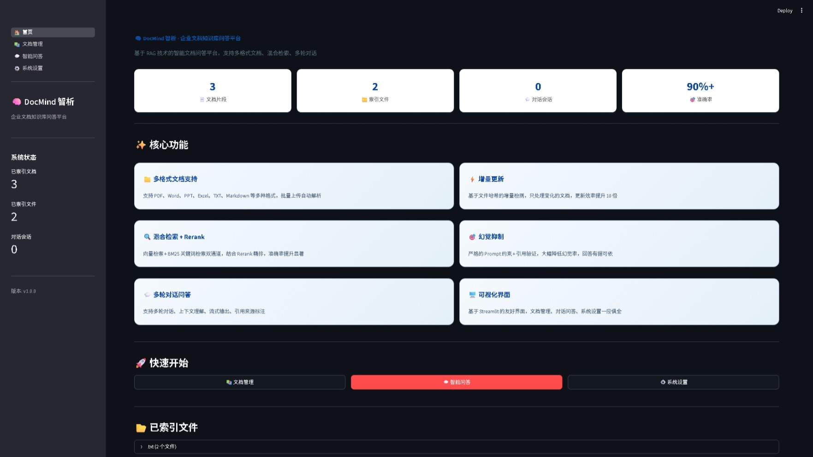
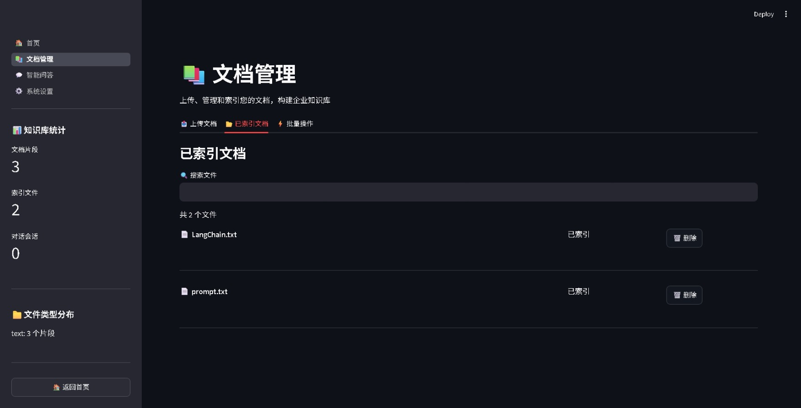
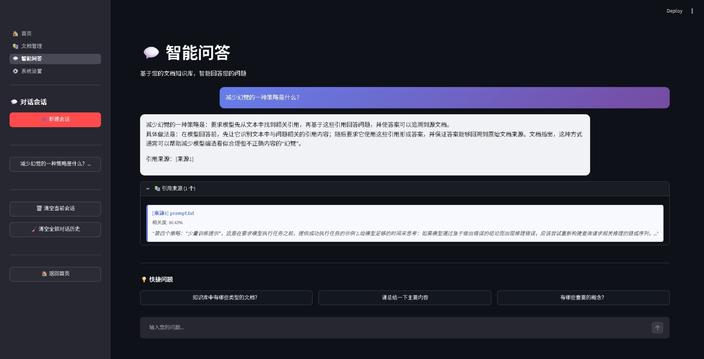
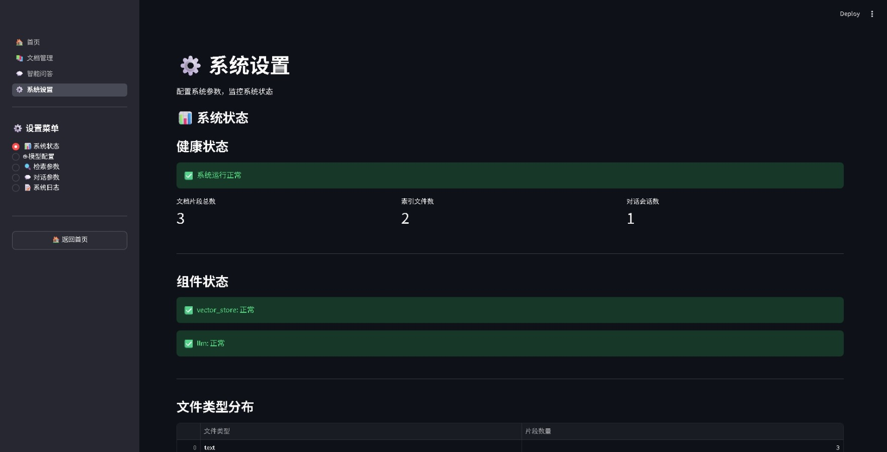
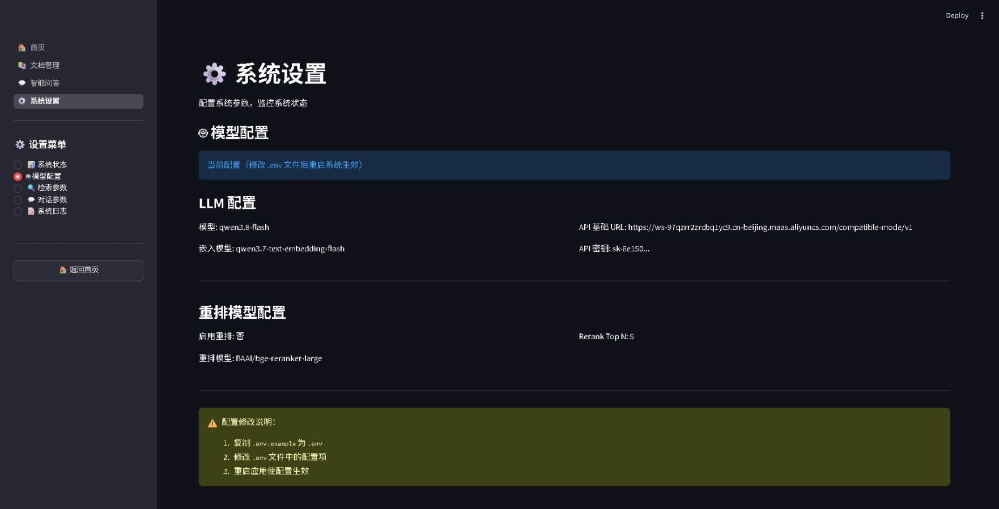
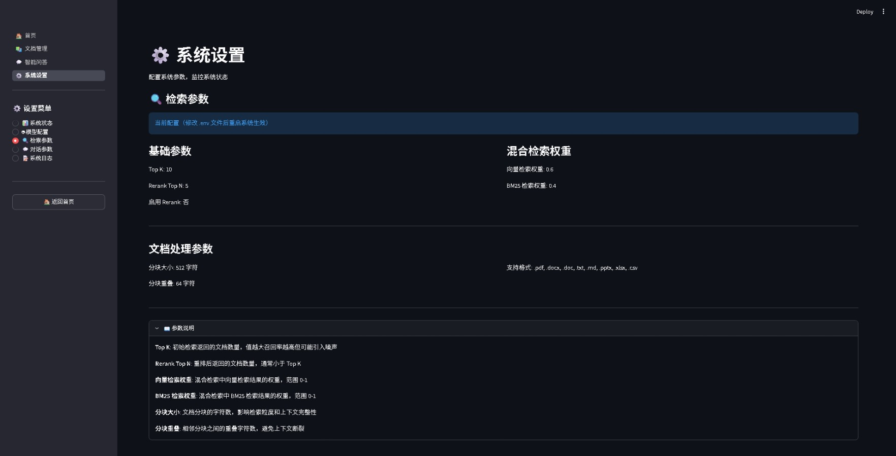
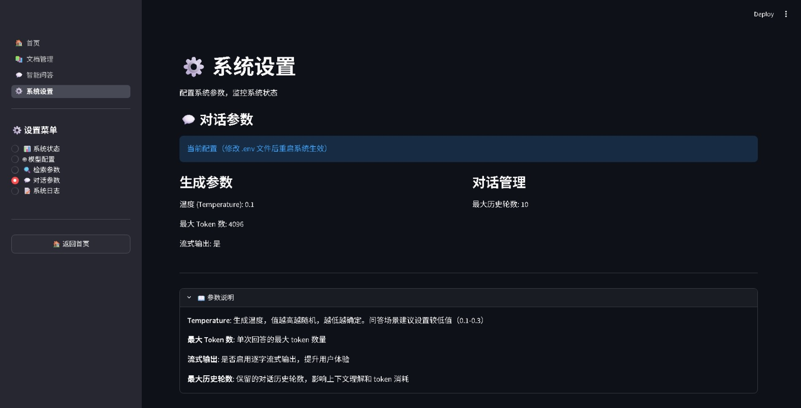
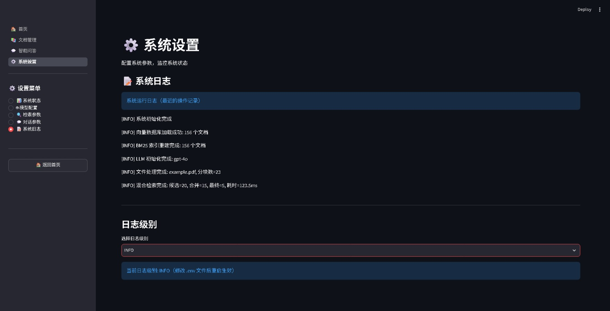
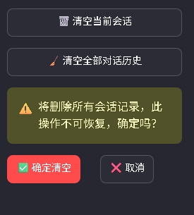

# 🧠 DocMind 智析 · 企业级文档知识库问答系统

> 基于 RAG（检索增强生成）的企业文档智能问答平台：上传 PDF / Word / PPT / Excel 等文档，用自然语言提问，AI 基于知识库内容作答并标注引用来源，有效减少大模型幻觉。

[](https://github.com/qie0403/ent-doc-qa/actions/workflows/ci.yml)
[](https://www.python.org/)
[](https://python.langchain.com/)
[](https://streamlit.io/)
[](https://www.trychroma.com/)
[](https://dashscope.aliyun.com/)
[](LICENSE)

适合：企业内部知识库问答、文档检索问答场景搭建，以及 RAG 工程化（分块、混合检索、幻觉抑制、多轮对话）的学习与演示。

## 🖼️ 功能截图

> 截图文件位于 `docs/images/`（截图清单与命名见该目录下的说明文件）。

| 首页仪表盘 | 文档管理 |
|---|---|
|  |  |
| **智能问答（带来源引用）** | **系统设置** |
|  |  |

系统设置子页面：

| 模型配置 | 检索参数 |
|---|---|
|  |  |
| **对话参数** | **系统日志** |
|  |  |

清空全部对话历史（二次确认防误删）：



## ✨ 核心功能

- **📁 多格式文档支持**：PDF、Word、PPT、Excel、CSV、TXT、Markdown、HTML，批量上传、自动解析、智能分块
- **🔍 混合检索**：向量检索（语义匹配）+ BM25 关键词检索（jieba 中文分词）双通道加权融合，兼顾语义与专有名词
- **🎯 Rerank 精排（可选）**：支持 BGE-Reranker / Cohere 交叉编码器重排；默认关闭，可一键开启
- **💬 多轮对话问答**：上下文问题改写、流式输出、引用来源标注（文件名/页码/相关度/片段）
- **🧹 对话管理**：多会话切换、新建会话、清空当前会话、清空全部对话历史（二次确认防误删）
- **⚡ 增量更新**：基于文件哈希检测变化，只处理新增/修改的文档，避免重复索引
- **🛡️ 幻觉抑制**：严格 Prompt 约束、基于检索引用作答、低温度生成（temperature=0.1）
- **🖥️ 可视化界面**：Streamlit 三页面（文档管理 / 智能问答 / 系统设置），开箱即用

## 🏗️ 技术架构与技术栈

```
┌─────────────────────────────────────────────────────────────┐
│                      Streamlit 前端                         │
│  ┌──────────┐  ┌──────────┐  ┌──────────┐                  │
│  │ 文档管理  │  │ 智能问答  │  │ 系统设置  │                  │
│  └──────────┘  └──────────┘  └──────────┘                  │
└───────────────────────────┬─────────────────────────────────┘
                            │
┌───────────────────────────▼─────────────────────────────────┐
│                     问答流水线 (QAPipeline)                  │
│  ┌─────────────┐  ┌─────────────┐  ┌─────────────────────┐ │
│  │ 文档处理模块  │  │  检索模块   │  │    LLM 问答模块     │ │
│  └─────────────┘  └─────────────┘  └─────────────────────┘ │
└───────────────────────────┬─────────────────────────────────┘
                            │
┌───────────────────────────▼─────────────────────────────────┐
│                      数据存储层                              │
│  ┌──────────────┐  ┌──────────────┐  ┌──────────────────┐  │
│  │ ChromaDB     │  │  BM25 索引   │  │  元数据 JSON      │  │
│  └──────────────┘  └──────────────┘  └──────────────────┘  │
└─────────────────────────────────────────────────────────────┘
```

| 层级 | 选型 | 说明 |
|------|------|------|
| 前端 | Streamlit | 三页面可视化界面 |
| 编排框架 | LangChain | 文档加载、文本分块、链编排 |
| 向量数据库 | ChromaDB | 本地持久化，零外部服务依赖 |
| 大模型 | 任意 OpenAI 兼容接口（已实测 `qwen3.8-flash`，可切换智谱 GLM、OpenAI 等） | 支持流式输出与推理模型 |
| 嵌入模型 | 与大模型同服务商的 OpenAI 兼容嵌入（已实测 `qwen3.7-text-embedding-flash`，1024 维） | 切换服务商后必须重建索引 |
| 混合检索 | jieba + BM25 + 向量加权 | 默认 BM25 权重 0.4 / 向量权重 0.6 |
| 重排（可选） | BGE-Reranker / Cohere | 默认关闭，需额外安装模型依赖 |
| 配置 | Pydantic Settings + `.env` | 类型安全，一处配置全局生效 |

## 🚀 快速开始

### 环境要求

- Python 3.10+（已在 3.10 / 3.13 上验证）
- 一个 OpenAI 兼容的 API Key（已实测阿里云百炼 MaaS 的 Qwen 系列，智谱、OpenAI 等也可）
- ⚠️ **聊天模型与嵌入模型必须来自同一服务商**（同一个 `OPENAI_BASE_URL`），切换服务商后必须重建索引

### 1. 克隆项目

```bash
git clone https://github.com/qie0403/ent-doc-qa.git
cd ent-doc-qa
```

### 2. 创建虚拟环境

```bash
# Windows
python -m venv venv
venv\Scripts\activate

# macOS/Linux
python3 -m venv venv
source venv/bin/activate
```

### 3. 安装依赖

```bash
# 方式一：允许较新版本（日常开发）
pip install -r requirements.txt

# 方式二：精确复现已验证环境（推荐用于部署 / CI）
pip install -r requirements.lock.txt
```

> `requirements.lock.txt` 由 `python scripts/gen_lock.py` 离线生成，记录了直接依赖的完整传递闭包与精确版本；升级依赖后重跑该命令即可更新。

### 4. 配置环境变量

```bash
# Windows
copy .env.example .env
# macOS/Linux
cp .env.example .env
```

编辑 `.env`，填入你使用的服务商配置（以下为已实测的阿里云百炼 MaaS）：

```env
# 阿里云百炼 MaaS（OpenAI 兼容接口）
OPENAI_API_KEY=your-api-key-here
OPENAI_BASE_URL=https://dashscope.aliyuncs.com/compatible-mode/v1
OPENAI_MODEL=qwen3.8-flash
OPENAI_EMBEDDING_MODEL=qwen3.7-text-embedding-flash
MAX_TOKENS=4096
```

> 注意：
> 1. 聊天模型与嵌入模型必须属于同一服务商；嵌入模型不能跨平台混用。
> 2. 更换嵌入模型后，旧向量库中的向量与新模型不兼容，必须执行 `python scripts/reindex.py` 全量重建索引。
> 3. qwen3 等推理模型会先输出思考过程，思考 token 也计入 `MAX_TOKENS`，建议设为 4096 及以上。
>
> 其他服务商（智谱、OpenAI 等）的配置见 `.env.example` 中的注释模板。

> 若使用 OpenAI 官方接口，将四项分别改为 `sk-` 开头的 Key、`https://api.openai.com/v1`、`gpt-4o`、`text-embedding-3-small`。
> 完整参数（分块大小、检索权重、重排开关等）见 `.env.example` 中的注释。

### 5. 启动应用

```bash
# 方式一：命令行
streamlit run app/main.py

# 方式二：Windows 一键启动
双击 run.bat
```

浏览器打开 `http://localhost:8501`，**首次进入先在首页点击「🔧 初始化系统」**，然后到「文档管理」页上传文档即可开始问答。

### 6. 运行测试（可选）

```bash
pytest tests/ -v
```

### 🐳 Docker 部署（可选）

```bash
# 方式一：docker compose（推荐，自动挂载 .env 与 data 目录）
docker compose up -d --build

# 方式二：手动构建运行
docker build -t ent-doc-qa .
docker run -p 8501:8501 --env-file .env -v ${PWD}/data:/app/data ent-doc-qa
```

## 📖 使用指南

1. **上传文档**：进入「文档管理」→ 上传文件 → 等待解析与索引 → 查看分块结果
2. **智能问答**：进入「智能问答」→ 输入问题 → 查看流式回答与引用来源，支持多轮追问与多会话管理
3. **系统设置**：查看系统状态、调整检索参数（top_k、混合权重、Rerank 开关）

## 📊 参数调优实测（分块大小 256 vs 512）

小语料上发现 256 分块会把完整知识点切碎（例如一个策略被拆到两个块），导致检索首条命中不理想。为此编写了可复现的评测脚本，用同一套分块器与 BM25 检索器（jieba 中文分词，与生产一致）做 A/B 对比。评测语料为入库的 `sample_data/`（新克隆仓库即可直接复现，无需先建向量库）：

```bash
# 一键复现评测（自动读取 sample_data/ 示例语料）
python scripts/ab_chunk_size.py

# 按指定分块大小全量重建索引（data/documents 为空时自动从 sample_data/ 复制示例语料）
$env:CHUNK_SIZE="256"; python scripts/reindex.py   # PowerShell
$env:CHUNK_SIZE="512"; python scripts/reindex.py
```

10 个固定测试问题的实测结果：

| 指标 | chunk_size=256 | chunk_size=512 |
|------|----------------|----------------|
| 分块数 | 6 | 3 |
| 平均块长（字符） | 200.2 | 409.3 |
| **Recall@1** | 60.0% | **100.0%** |
| Recall@3 | 100.0% | 100.0% |
| **MRR** | 0.783 | **1.000** |

结论：512 分块语义更完整，Recall@1 提升 40 个百分点、MRR 提升至 1.000，因此生产配置采用 512。该结论基于 2 篇短文、10 个问题的演示集，大规模语料建议用同一脚本重新评测。

## 📁 项目结构

```
ent-doc-qa/
├── app/                         # Streamlit 应用
│   ├── main.py                  # 应用入口（st.navigation 挂载导航，启动文件）
│   └── pages/                   # 首页 / 文档管理 / 智能问答 / 系统设置
├── config/
│   └── settings.py              # 全局配置（Pydantic Settings）
├── src/
│   ├── document_processor/      # 解析、智能分块、增量更新
│   ├── vector_store/            # 嵌入模型、ChromaDB 封装
│   ├── retriever/               # BM25、混合检索、Rerank
│   ├── llm/                     # Prompt、对话历史、对话管理
│   └── pipeline/qa_pipeline.py  # 系统核心编排入口
├── scripts/
│   ├── ab_chunk_size.py         # 分块大小 A/B 评测脚本
│   ├── reindex.py               # 按当前 CHUNK_SIZE 全量重建索引
│   ├── restore_corpus.py        # 从向量库还原语料
│   └── gen_lock.py              # 生成 requirements.lock.txt（离线解析依赖树）
├── tests/                       # pytest 测试
├── sample_data/                 # 入库示例语料（评测与重建索引的可复现数据源）
├── docs/
│   ├── ARCHITECTURE.md          # 技术架构文档
│   ├── OPTIMIZATION.md          # 优化策略文档
│   └── images/                  # README 功能截图
├── data/                        # 文档与向量库（运行时数据，不入库）
├── .github/workflows/ci.yml     # GitHub Actions CI（push/PR 自动跑测试）
├── .env.example                 # 环境变量模板
├── requirements.txt             # 直接依赖（版本下界）
├── requirements.lock.txt        # 依赖锁定（传递闭包，精确版本）
├── Dockerfile / docker-compose.yml / .dockerignore
├── run.bat                      # Windows 一键启动
└── LICENSE
```

## 🎯 性能指标

**已实测（演示语料）：**
- 512 分块下 Recall@1 = 100%、MRR = 1.000（评测集 10 个问题，见上表）
- 端到端问答（含检索 + 推理模型流式生成，含思考过程）约 5–15s（视模型与问题复杂度）

**设计目标（大规模语料下需用自有数据验证）：**

| 指标 | 目标值 |
|------|--------|
| 问答准确率 | ≥ 90% |
| 幻觉率 | ≤ 5% |
| 检索召回率 | ≥ 90% |
| Top-5 准确率 | ≥ 95% |
| 引用准确率 | ≥ 95% |

## 🔧 常见问题

**Q：如何切换模型供应商？**
A：修改 `.env` 中四个 `OPENAI_*` 变量即可，所有接口均为 OpenAI 兼容协议（阿里百炼、智谱、DeepSeek、本地 Ollama 等均可）。注意嵌入模型必须与 `OPENAI_BASE_URL` 同服务商，换完后执行 `python scripts/reindex.py` 重建索引。

**Q：如何开启 Rerank？**
A：安装 `FlagEmbedding`（或配置 Cohere Key），在 `.env` 中设置 `ENABLE_RERANK=true`。

**Q：如何进一步提升问答准确率？**
A：调整分块大小/重叠（可先用 `scripts/ab_chunk_size.py` 评测）、增大 `TOP_K` / `RERANK_TOP_N`、开启 Rerank、提高文档结构质量。

**Q：支持完全离线部署吗？**
A：支持。嵌入与 LLM 换成本地模型（如 BGE + Ollama），向量库使用本地 ChromaDB 即可。

## 📚 详细文档

- [技术架构文档](docs/ARCHITECTURE.md)：系统架构、模块设计、数据模型
- [优化策略文档](docs/OPTIMIZATION.md)：幻觉抑制、检索优化、性能优化

## 🤝 贡献

欢迎 Issue 与 PR：Fork → 特性分支 → 提交 → Push → Pull Request。

推送与 PR 会触发 GitHub Actions CI（Python 3.11 / 3.13 双版本矩阵）自动运行 `pytest`，请确保本地测试通过后再提交。

## 📄 许可证

[MIT](LICENSE)

---

**如果这个项目对你有帮助，欢迎点一个 ⭐ Star！** 问题与建议请提交到 [Issues](https://github.com/qie0403/ent-doc-qa/issues)。
